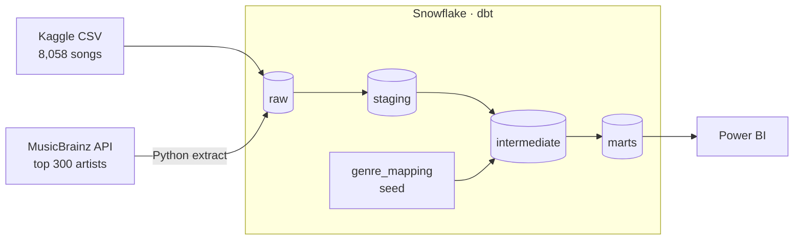
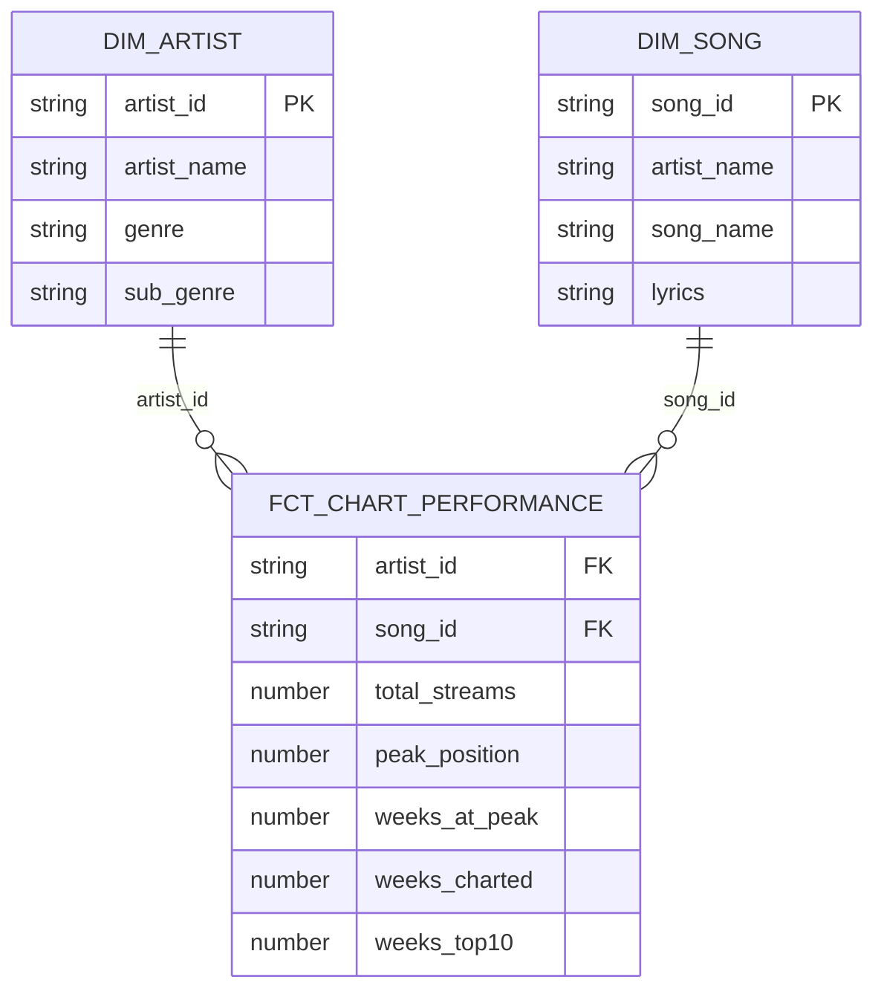

# Spotify Chart Analytics · dbt + Snowflake

[](https://github.com/adamwillner/spotify-project/actions/workflows/dbt_test.yml)

Turns 8,000+ Spotify chart songs into a tested star schema, enriched with artist genres from an open API, ready for Power BI.

## Pipeline



*raw → staging → marts is dbt's naming; the same idea as bronze → silver → gold.*

## Star schema



**Drill-down:** Genre → Sub-genre → Artist → Song, like Category → Subcategory → Brand → Product in a product catalogue.

## At a glance

| | |
|---|---|
| Songs | **8,058** |
| Artists | **1,795** |
| Artists looked up in MusicBrainz | **300** (~83 % of streams) |
| Artists with a genre | **278**, covering **~80 % of streams** |
| Broad genres | **8** + Other + Unclassified |
| Tests | Keys, relationships and allowed values, on every build |
| CI | `dbt build` on every push to `main` |

## Stack

Snowflake · dbt-core 1.12 · dbt_utils · Python · GitHub Actions · Power BI

## Where to find things

| Folder | What's in it |
|---|---|
| [`setup/`](setup/README.md) | Snowflake setup scripts and **how to build it from scratch** |
| [`extract/`](extract/README.md) | The MusicBrainz API extract: how matching works, coverage, limitations |
| [`models/`](models/README.md) | The dbt models layer by layer, genre logic, tests and data notes |
| `seeds/` | `genre_mapping.csv`: detailed MusicBrainz genres → 8 broad genres |
| `macros/` | Reusable SQL: schema naming, `(x13)` cleanup, missing-artist fallback |
| `tests/` | Custom tests, incl. a warning for unmapped genres |

## Quick start

```
dbt deps
dbt build
dbt docs generate && dbt docs serve   # docs + lineage graph
```

First time? See [setup/README.md](setup/README.md).

**Data:** [Spotify Global Chart Totals & Lyrics](https://www.kaggle.com/datasets/batudev/spotify-global-chart-totals-and-lyrics) (Kaggle) · genres from [MusicBrainz](https://musicbrainz.org/doc/MusicBrainz_API)
