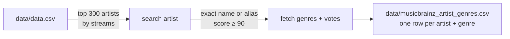

# MusicBrainz extract

`musicbrainz_genres.py` looks up artist genres in [MusicBrainz](https://musicbrainz.org/doc/MusicBrainz_API), an open music database. It runs once; the result is loaded into `raw` by `setup/03_musicbrainz.sql`.



## Run

```
python extract/musicbrainz_genres.py
```

About 11 minutes: MusicBrainz allows ~1 request per second, and each artist takes 2 requests. If it stops (network problem), run it again: it skips artists already in the output file. Settings (number of artists, match score) are variables at the top of the script.

## Matching rules

- A search hit only counts if its score is **90+** and its **name or one of its aliases** is exactly the chart's artist name. This rejects e.g. "Kanye West Tribute Band", and aliases catch renamed artists.
- If MusicBrainz has several entries with the same name, the first one **with genres** is used.

## Result

| | Artists |
|---|---|
| Looked up | 300 |
| Found | 288 |
| With genres | 278 |
| Not found (special characters, short names, renamed) | 12 |
| Found, but no genres yet (often newer artists) | 10 |

## Known limitations

- Ambiguous names can still match the wrong artist (BTS member Jin → rapper MC Jin, R&B singer Steve Lacy → jazz musician Steve Lacy).
- Genres are per artist, not per song.
- MusicBrainz is community-edited, so coverage is uneven.
